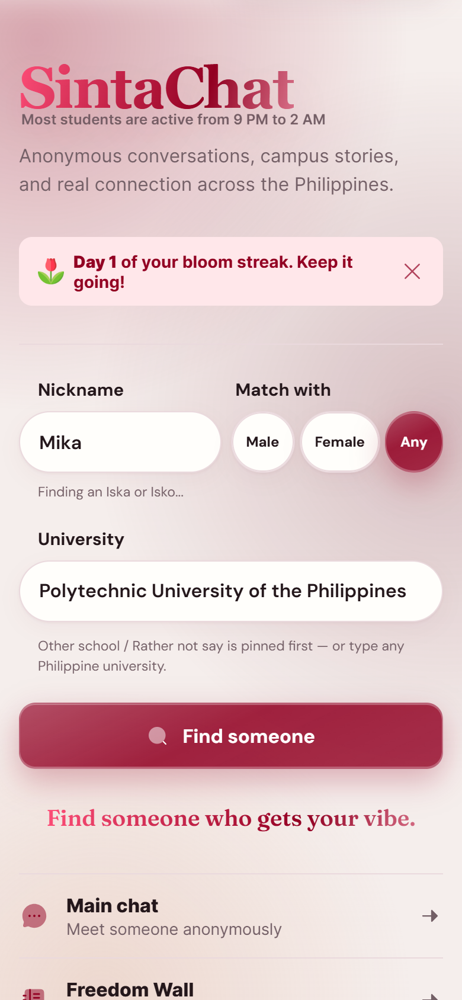
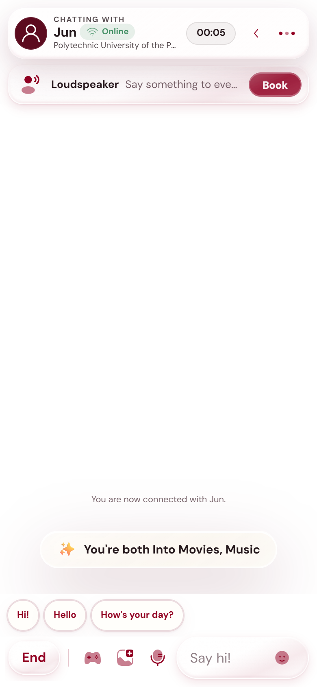
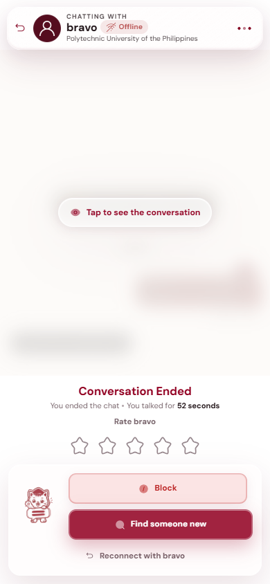
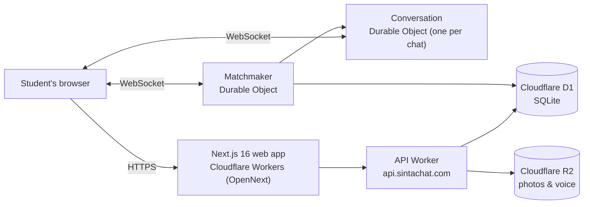
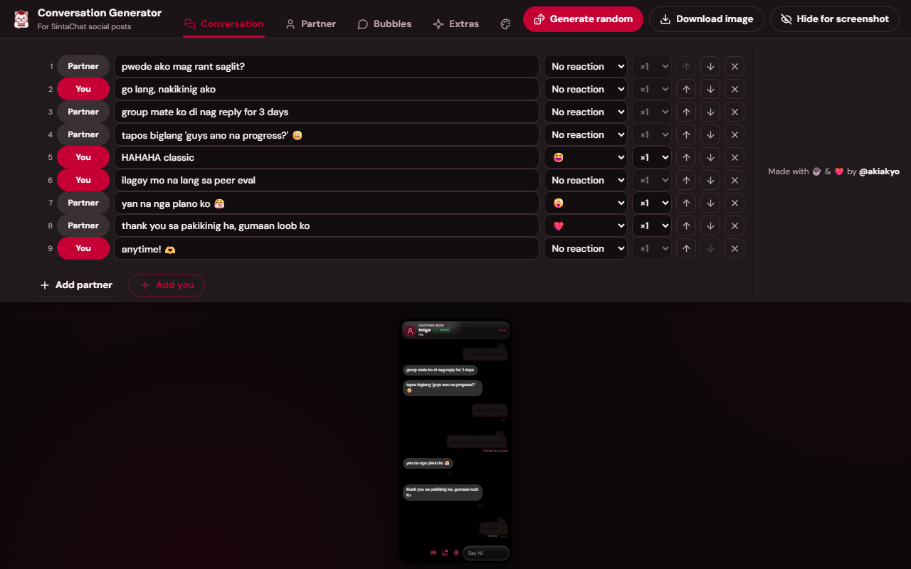

  

<h1 align="center">SintaChat</h1>

  <b>Anonymous conversations, campus stories, and real connection across the Philippines.</b> 
  <a href="https://sintachat.com">sintachat.com</a> ·
  <a href="https://team.sintachat.com">The Team</a> ·
  <a href="https://www.facebook.com/officialsintachat">Facebook</a> ·
  <a href="https://www.instagram.com/sintachat">Instagram</a> ·
  <a href="https://www.tiktok.com/@sintachat">TikTok</a>

  
  
  
  

---

> [!NOTE]
> **This is a showcase, not the source code.** SintaChat's codebase is private. This repository shares how SintaChat works: its documents, its matchmaking algorithm, a few code excerpts, the API it exposes, and the people and projects behind it. See [License](#license).

## What is SintaChat?

SintaChat is an anonymous chat platform for students aged 18 and above in the Philippines. You pick a nickname, say who you'd like to meet, and get matched with another student in seconds. No account, no followers, no public persona.

The name comes from the Filipino word *sinta*, someone held dear. SintaChat was started by Computer Engineering students at the Polytechnic University of the Philippines, but it's open to eligible students everywhere in the country.

  
  
  
  

## Features

| | |
|---|---|
| 💬 **Anonymous chat** | One-to-one, real-time, with no sign-up. Text, photos, voice messages, GIFs, stickers and songs. |
| 🎯 **Matchmaking** | Match with Male, Female or Any. Gender is never assumed from your own, and a search widens after 10 seconds. [How it works →](docs/matchmaking.md) |
| 🎮 **In-chat games** | Play together without leaving the chat: UNO, billiards, Connect Four, Wordle, Word Hunt, drawing, trivia and riddles. |
| 📌 **Freedom Wall** | An anonymous campus board for posts, replies and reactions, plus **SintaChat Notes**: 24-hour notes with text, a GIF or a song. |
| 🌱 **Bloom Streaks** | Come back daily and your chat bubbles grow, from a first seedling to a year-long White Bloom. |
| 🕘 **History & reconnect** | Save people you clicked with and ask to talk again. They have to accept. |
| 🛡️ **Safety** | Reporting, blocking, a profanity filter, and a moderation team that reviews reports and the wall. |
| 💎 **Supporter, Plus & Pro** | Optional plans that keep SintaChat running. They add perks; the free experience is never taken away. |

## How it's built

Everything runs on **Cloudflare**: the web app, the API, real-time chat and storage. There are no servers to keep awake, and matching happens at the edge. [Architecture →](docs/architecture.md)

| Layer | Technology |
|---|---|
| Web | Next.js 16, React 19, TypeScript, OpenNext for Cloudflare |
| API | Cloudflare Workers, TypeScript |
| Real time | Durable Objects with WebSockets (one Matchmaker, one Conversation per chat) |
| Data | Cloudflare D1 (SQLite), Cloudflare R2 |
| Email | Resend |
| Payments | PayMongo |

## Documents

| Document | What's in it |
|---|---|
| [Matchmaking](docs/matchmaking.md) | Who gets paired with whom, and why: compatibility, the waiting pool, ranking, timers, fairness |
| [Architecture](docs/architecture.md) | How the web app, API, Durable Objects and storage fit together |
| [API](docs/api.md) | The public endpoints and the chat's real-time events |
| [Team](TEAM.md) | The people who build, run and look after SintaChat |
| [Credits](CREDITS.md) | Third-party icons, fonts, sounds and services |

## Code excerpts

Selected files, shared to read, not to run:

| File | What it is |
|---|---|
| [`src/matchmaking.ts`](src/matchmaking.ts) | The matching rules as pure functions: who accepts whom, which buckets to search, and how candidates are ranked |

## Tools

### Conversation Generator

**[conversation.sintachat.com](https://conversation.sintachat.com)**, made by **aky** ([@akiakyo](https://github.com/akiakyo)).

Builds SintaChat chat screenshots for social media posts. Write the conversation line by line,
then set the partner's nickname, school and vibe, the bubble skins, reactions and badges, and
extras like the ended screen or the Loudspeaker. It downloads as an image sized for a phone, a
story (9:16), a post (4:5) or a square. The preview uses the live chat room's own styles, so every
image looks exactly like the real app.

  

## The team

SintaChat is built and maintained by the **SintaChat Team**, Computer Engineering students at the Polytechnic University of the Philippines specializing in Software and Network Engineering.

Founded by **aky** (Project Lead), with co-founders **Ark**, **Johnxei**, **Dustine**, **Kedu** and **CJ**. [Meet everyone →](TEAM.md)

## Policies

Using SintaChat means agreeing to its policies. The official, current versions live on sintachat.com:

| Policy | What it covers |
|---|---|
| [Terms of Service](https://sintachat.com/terms) | The rules for using SintaChat, including the 18+ age requirement |
| [Privacy Policy](https://sintachat.com/privacy) | What SintaChat collects, why, and how long it's kept |
| [Community Guidelines](https://sintachat.com/guidelines) | How to treat people in chats and on the Freedom Wall |
| [Safety Policy](https://sintachat.com/safety) | Staying safe while talking with strangers, and how reporting works |

## License

© 2026 SintaChat. All rights reserved.

This repository is shared **for viewing only**. You may read it and link to it. You may not copy, modify, redistribute or use any part of it, including the code excerpts, documents and images, without written permission. See [LICENSE](LICENSE).

Third-party work keeps its own license; see [CREDITS.md](CREDITS.md).
