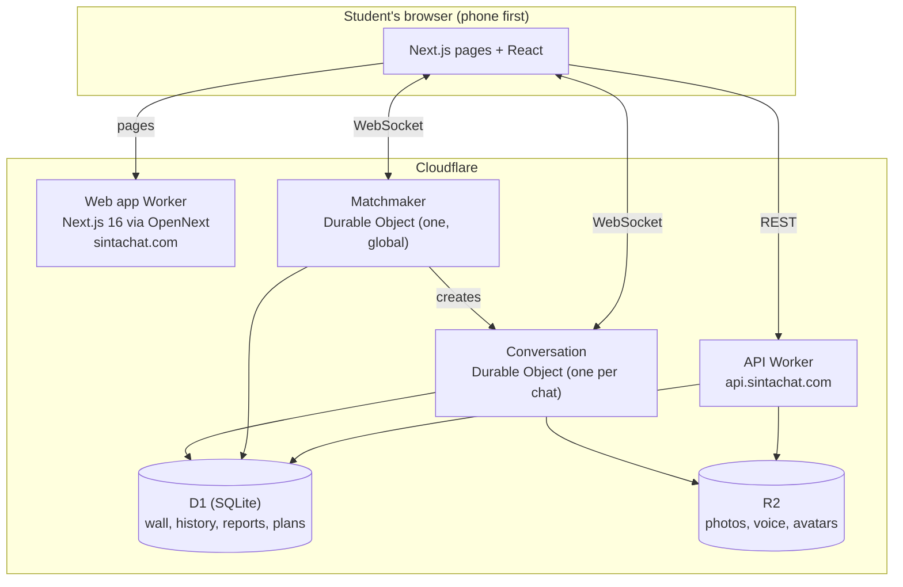

# SintaChat Architecture

**Author:** aky ([@akiakyo](https://github.com/akiakyo)), SintaChat

SintaChat runs entirely on **Cloudflare**. There are no long-running servers: the web app, the API
and real-time chat all run as Workers at the edge, close to students across the Philippines. The
project is built by students, so the whole stack is also chosen to stay inside a small monthly
budget.

## The pieces

| Piece | Job |
|---|---|
| **Web app** | Next.js 16 and React 19, built for Cloudflare with OpenNext. Most pages are static or cached; the chat room is a client app. |
| **API Worker** | Plain TypeScript on Workers. The Freedom Wall, Notes, History, reports, plans and payments, notifications, GIF and song search. |
| **Matchmaker** | One Durable Object holds the waiting pool and pairs people. Because a Durable Object handles one event at a time, two searches can never claim the same person. [Matchmaking →](matchmaking.md) |
| **Conversation** | A Durable Object for each chat. It holds both people's sockets, the messages, typing and seen states, reactions, and the state of every in-chat game. |
| **D1** | Cloudflare's SQLite database, for everything that outlives a chat. |
| **R2** | Object storage for photos, voice messages and profile pictures. |

## A chat, from start to finish

1. **Consent.** The age and terms agreement comes first, before the home page.
2. **Match form.** Nickname, who you'd like to meet, and university. No account; the browser keeps
   an anonymous session.
3. **Matching.** The browser opens a WebSocket to the Matchmaker and sends `find-match` once. The
   Matchmaker either pairs immediately or keeps the person in its pool.
4. **The chat.** On a match, the Matchmaker creates a Conversation and tells both people its ID.
   Each browser connects to that Conversation. Messages, games and presence all flow through it.
5. **The end.** Either person ends the chat. Both can rate it, block, add each other to History, or
   find someone new.

## Design choices

- **No accounts.** People chat under a nickname with an anonymous session. Optional Google sign-in
  only keeps a session across devices; it never gates chatting.
- **Built for low-end phones.** Many students use budget Android phones, so there are no endless
  animations or heavy blur in the chat room, and the message list does the least work it can per
  keystroke.
- **Moderation on the server.** Bans and suspensions are checked by the Matchmaker and the API, not
  trusted from the browser.
- **Database ahead of the code.** Schema changes are small, additive migrations, applied before the
  code that reads them is deployed.
- **Cost-aware.** No polling loops; real-time updates arrive over the sockets that are already open.
