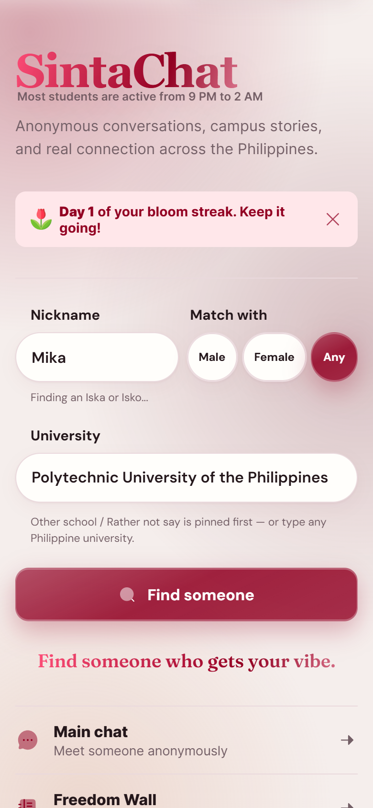
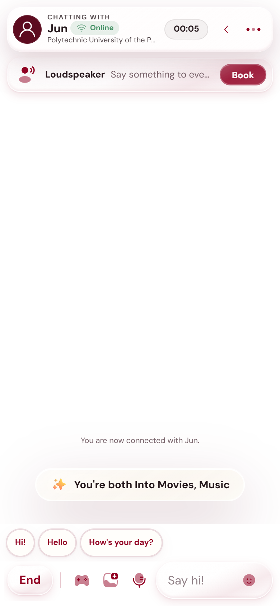
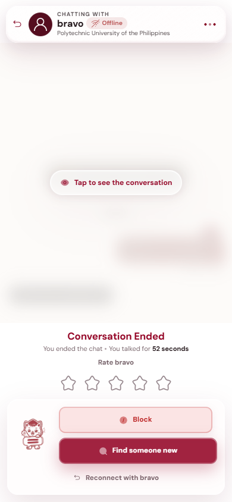
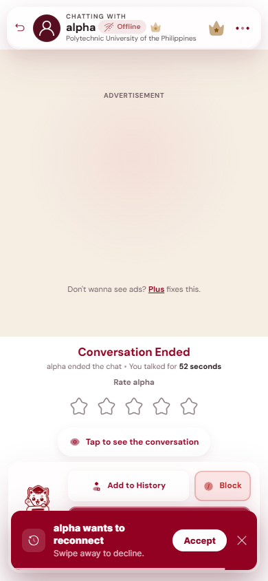

# SintaChat Matchmaking

**Author:** aky ([@akiakyo](https://github.com/akiakyo)), SintaChat
**Last updated:** November 8, 2026

How SintaChat decides who gets paired with whom, from the moment someone taps **Find someone** to
the moment the chat opens. Several choices below look arbitrary on their own, and they are not.

| Where | What it does |
|---|---|
| [`lib/matchmaking.ts`](../src/matchmaking.ts) (shared here) | The rules themselves, as plain functions with no storage: who accepts whom, which buckets to search, who wins |
| `do/matchmaker.ts` | The one `Matchmaker` Durable Object: the waiting pool, sockets, the alarm, pairing |
| `components/home/MatchForm.tsx` | The match form on the home page |
| `app/finding/page.tsx` | The searching screen; calls `find-match` once |

## What people see

<table>
  <tr>
    <td align="center" width="33%"><br><sub><b>1. Match form.</b> Nickname, Match with, university.</sub></td>
    <td align="center" width="33%"><br><sub><b>2. Searching.</b> <code>find-match</code> runs once; the person waits in the pool.</sub></td>
    <td align="center" width="33%"><br><sub><b>3. Matched.</b> The chat opens with shared interests.</sub></td>
  </tr>
  <tr>
    <td align="center"><br><sub><b>4. Ended.</b> Find someone new, or Reconnect (a paid perk).</sub></td>
    <td align="center"><br><sub><b>5. Reconnect invite.</b> The other person accepts or swipes it away.</sub></td>
    <td></td>
  </tr>
</table>

Gender is asked once, the first time someone searches, and can be changed later on
**Preferences**. **Match with** is on the form every time.

## The core rule

**Match with names who a person is looking for, on its own. It is never inferred from their own
gender.** Male does not imply "wants Female," and Female does not imply "wants Male." Two people who
both picked Match with: Male are a normal, first-class match, exactly as ordinary as two who both
picked Female, or a male and a female who want each other. None of these is a fallback.

```
Gender:     Male | Female | Rather Not Say
Match with: Male | Female | Any
```

**Match with has no Rather Not Say option.** Nobody can specifically look for a Rather Not Say
person, so a Rather Not Say person is only found by someone whose Match with is Any. That follows
from the two lists being different sizes; it is not an oversight. A Rather Not Say person can still
look for anyone they like.

## Compatibility

Two functions in `lib/matchmaking.ts`, and nothing about matching skips them:

```ts
function accepts(matchWith: MatchWith, candidateGender: Gender): boolean {
  return matchWith === "anyone" || matchWith === candidateGender;
}

function mutuallyCompatible(a, b): boolean {
  return accepts(a.matchWith, b.gender) && accepts(b.matchWith, a.gender);
}
```

Both directions have to hold. A match where only one side is willing is not a match.

| Searcher | Candidate | Match? | Why |
|---|---|---|---|
| Male, wants Male | Male, wants Male | ✅ | Both get exactly what they asked for |
| Female, wants Female | Female, wants Female | ✅ | Both get exactly what they asked for |
| Male, wants Male | Male, wants Female | ❌ | The candidate does not accept the searcher |
| Male, wants Female | Female, wants Male | ✅ | Both get exactly what they asked for |
| Female, wants Any | Female, wants Female | ✅ | Any accepts everyone who accepts back |
| Male, wants Female | Rather Not Say, wants Any | ❌ | `accepts("female", "unspecified")` is false |
| Rather Not Say, wants Any | Male, wants Any | ✅ | Any on both sides always works |

There used to be a third rule that let a candidate with no stated gender through any search. It was
removed: a Match with: Female search could be handed someone who never said they were a woman.

## The waiting pool

The pool is split into nine buckets by `(gender, matchWith)`:

```
waiting pool
├── male         { wants male, wants female, wants any }
├── female       { wants male, wants female, wants any }
└── unspecified  { wants male, wants female, wants any }
```

Each waiting person is stored twice in Durable Object storage, written and removed together:

- `q:<session>`: the full record (`{ session, profile, since }`).
- `qb:<gender>:<matchWith>:<since, zero-padded>:<session>`: a pointer in their bucket. Storage
  lists keys in order, so each bucket comes back **oldest first** with no sorting.

A search only lists the buckets that could hold a valid candidate: up to two while searching for
the exact gender, up to six once the search widens. Never all nine, never the whole pool.

## The search, step by step

For someone with `(gender, matchWith)` who started waiting at `since`:

1. **Refused if restricted.** A banned or suspended session never reaches the pool; the searching
   screen says why and until when.
2. **Already in a chat?** They are sent back to it.
3. **Keep the original wait time.** Searching again while already waiting keeps the first
   `since`, so reloading the page never resets the timer or the queue position.
4. **Which phase?**
   - **Exact:** for the first **10 seconds**, only the gender they asked for.
   - **Widened:** after that, any gender, as long as the other person accepts theirs.
   - **Match with: Any** starts widened; there is nothing to wait for.
5. **Gather candidates** from the relevant buckets, then make three reads however many there are:
   the block list (either direction), every candidate's record, and who this person has met
   before.
6. **Drop** anyone blocked, anyone whose socket is gone (their stale entry is cleaned up), and
   anyone who fails `mutuallyCompatible` (a second check; the buckets should already guarantee
   it).
7. **Pro campus first.** If either person is Pro and picked a university, for their first 10
   seconds only someone from that university counts.
8. **Rank** the rest (below) and pair with the best. With nobody, they join the pool and wait.

**Widening only loosens the searcher's own choice.** The other person's Match with is checked the
same way in both phases. Waiting longer makes *you* open to more people. It never makes anyone else
accept someone they did not ask for.

### Who wins when there are several

In order:

1. **The gender actually asked for.** Once widened, someone of the requested gender still beats
   everyone else, so widening never hands over the wrong gender while the right one is waiting.
2. **Matched first.** Pro (priority 2), then Supporter, Plus and Notable (priority 1, sharing one
   level), then everyone else. Defined in `lib/plus/tiers.ts`.
3. **Someone new** over someone already met. Having met before lowers priority; it never blocks.
4. **Longest waiting.** Buckets are already oldest first, and a tie keeps whoever was found first.

## Timers

| Window | Length | Who it applies to |
|---|---|---|
| Exact gender | 10 seconds, everyone | Anyone with Match with: Male or Female |
| Pro campus first | 10 seconds | Pro users who picked a university |
| Reconnect invite | Until it expires | The person who was asked |

The exact-gender window used to be 30 seconds for men and 60 for women and Rather Not Say. People
kept reporting the wait, so it became 10 seconds for everyone. The trade-off is deliberate: speed
over exact preference. The table in `PREFERRED_WINDOW_MS` is still per gender, so a split could
come back by editing one table. The searching screen tells people when the search widens
(`WIDENS_AFTER_MS` in `finding/page.tsx`), so change both together.

**Nothing polls.** `find-match` runs once per visit to the searching screen. If someone is waiting
alone when their window closes, nobody new would search to find them. The Durable Object's single
alarm covers that moment: when a window closes, it gives that person **one** widened search. If it
still finds nobody, they keep waiting until the next person searches and finds them. The same
alarm expires unanswered reconnect invites.

After pairing, the match reveal holds for about 7 seconds on purpose (until the vibe card shows,
plus 1.5 seconds). That is on the web side and does not slow matching itself.

## Blocked vs. met before

| | Blocked | Met before |
|---|---|---|
| Stored in | D1 `blocks` table | `pm:<a>:<b>` in Durable Object storage, written on every pairing |
| Effect | **Never** matched, however few people are waiting | Lower priority than someone new; still matched if nobody new is there |
| Goes away with time | No | Not needed; it only ever lowers priority |

`pm:` is not the same as `lp:<session>`. `lp:` only remembers the **latest** partner, for
Reconnect on the ended screen. `pm:` keeps everyone, in both directions.

## Reconnecting

Two ways back to someone, both through the same `pair()` and the same alarm:

- **`request-rematch`:** Reconnect on the ended screen, using `lp:`. A paid perk; free users see the
  upgrade instead.
- **`request-reconnect`:** reconnecting from **History**.

The other person gets an invite (screenshot 5) and has to accept. Since November 8, 2026 a
reconnected chat always opens fresh for both people, never showing the previous chat's messages
(`HomeShell.tsx` remounts the chat room for each new match).

## Why two searches never get the same person

There is exactly **one** `Matchmaker` Durable Object (`idFromName("global")`). Cloudflare runs one
event at a time per Durable Object, so `fetch`, `alarm` and every socket message wait their turn. A
whole `find-match` (search, pick, remove both people, create the chat) finishes before the next
event starts, including another search that arrived at the same moment. No extra lock is needed.
Splitting the matchmaker into several objects would bring the race back, so that has not been done.

## Cost

| Operation | Cost |
|---|---|
| Find a session's record | One key read |
| Blocked check | One query per search, not per candidate |
| Met-before check | One batched read per search |
| Join or leave the pool | Two keys written or deleted together |
| Search | Size of 1 to 6 buckets, never the whole pool |
| Alarm sweep | Everyone waiting, but only when a deadline passes |
